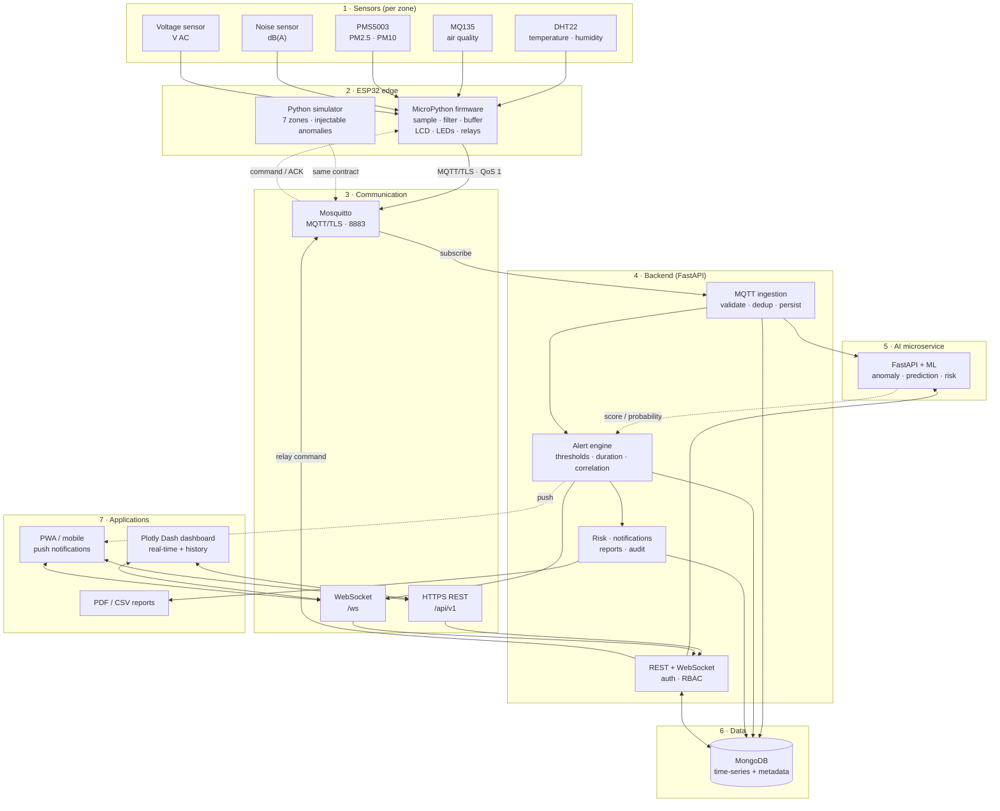
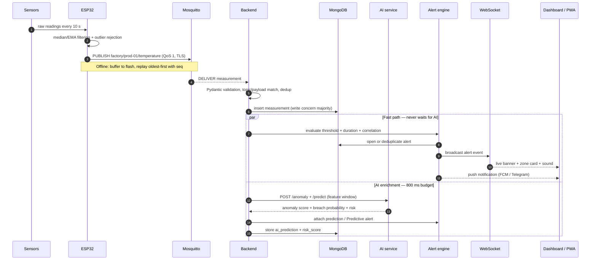

# Phase 1 — Architecture

**Status:** Phase 1 baseline. No application code is implemented yet.

## 1. Design decisions

| Decision | Choice | Rationale |
|---|---|---|
| Dashboard framework | **Plotly Dash** | Multi-page routing, callback model, Flask-level auth integration, `dash-extensions` WebSocket client, and static PWA assets fit the real-time + RBAC requirements better than Streamlit's rerun model. Streamlit would require polling or custom components for server push. |
| Messaging | **MQTT 3.1.1 over TLS** | MicroPython `umqtt` compatibility; QoS 1 gives at-least-once delivery; TLS + per-device ACLs protect industrial data. |
| Data store | **MongoDB time-series collection** | Native time bucketing and compression for high-volume timestamped measurements; metadata collections remain normal documents. |
| AI isolation | Separate FastAPI service | Keeps `scikit-learn`/`tensorflow` out of the API process, allows independent retraining/restart, and enforces an explicit HTTP contract. |
| Alert ordering | Threshold/correlation path is synchronous; AI is concurrent enrichment | A critical alert must never wait for, or be lost because of, the AI service. AI can only add Predictive level/risk context. |
| Edge autonomy | Local filtering, buffering, LCD/LED status, fail-safe relays | The device keeps operating and shows status when the network or backend is unavailable. |
| Authentication | JWT access + refresh, OAuth2 password flow | Standard FastAPI pattern; short-lived access tokens limit exposure; refresh rotation supports revocation. |

## 2. Seven-layer architecture

**Layer responsibilities**

| Layer | Owns | Must not do |
|---|---|---|
| 1 Sensors | Physical measurement | Direct network access |
| 2 ESP32 | Sampling, filtering, buffering, local display, relay actuation | Business rules, long-term storage |
| 3 Communication | MQTT broker, HTTPS, WebSocket transport | Business logic |
| 4 Backend | Validation, persistence, alerting, RBAC, orchestration, audit | ML model hosting |
| 5 AI service | Feature windows, inference, model registry, retraining | Direct writes to Mongo or broker |
| 6 MongoDB | Measurements and metadata history | Serving the UI directly |
| 7 Applications | Visualization, notification UX, exports | Direct MQTT or database access |

## 3. Measurement → alert → dashboard sequence

## 4. Critical-path budget

| Stage | p95 budget | Notes |
|---|---:|---|
| ESP32 sampling + filtering | 50 ms | Runs continuously; publish immediately after the 10 s tick. |
| MQTT publish → backend delivery | 100 ms | QoS 1 over TLS on the local network. |
| Validation + dedup | 50 ms | In-memory LRU for `(device_id, seq)`; no blocking calls. |
| Mongo insert | 100 ms | Acknowledged write; time-series insert. |
| Alert evaluation | 20 ms | Pure in-memory rule evaluation after rules are cached. |
| WebSocket broadcast | 100 ms | Push to connected dashboard clients. |
| **Critical path total** | **≈ 420 ms** | Leaves > 1.5 s margin under the 2 s requirement. |
| AI inference (parallel) | 500 ms | Timeout 800 ms; omitted from critical path. |

**Why AI is off the critical path:** threshold and correlation alerts are deterministic and must fire even when the AI service is down or slow. AI results arrive concurrently and create/upgrade `Predictive` alerts and risk scores. If the AI call times out, the measurement and threshold alert are still durable.

## 5. Failure and degradation behavior

| Failure | Behavior |
|---|---|
| Wi-Fi or broker unavailable at the edge | Buffer ≥8 h in flash; LCD/LED shows offline; replay oldest-first on reconnect. |
| Backend down | Mosquitto persistent session queues QoS 1 data up to configured limits; devices also buffer; dashboard shows disconnected state. |
| AI service down/slow | 800 ms client timeout; threshold/correlation alerts continue; `Predictive`/risk marked unavailable; no retry storm. |
| MongoDB down | Ingestion pauses with bounded retry; health endpoint reports degraded; MQTT QoS 1 + persistent backend session limits loss. |
| WebSocket down | Dashboard reconnects with exponential backoff; REST polling fallback for the last known values. |
| Stale command | Commands carry `expires_at`; device rejects expired commands and ACKs `rejected`. |
| Power loss | Relays return to configured fail-safe state; device republishes retained status/state after boot. |
| Duplicate QoS 1 delivery | Measurement dedup via `(device_id, seq)`; alert dedup via unique active `dedup_key`. |

## 6. Deployment topology

| Compose service | Image / role | Exposed | Persistence |
|---|---|---|---|
| `mosquitto` | Eclipse Mosquitto 2.x, TLS 8883, ACLs | 8883 (dev only) | Broker persistence volume |
| `mongodb` | MongoDB 7.x, time-series + validators | Internal only | `mongo_data` volume |
| `backend` | FastAPI/Uvicorn, MQTT client, scheduler | 8000 internal | Stateless |
| `ai_service` | FastAPI + ML runtime | 8001 internal | Model/report volume |
| `dashboard` | Plotly Dash/Gunicorn | 8050 internal | Stateless |
| `simulator` | Python MQTT publisher | none | Stateless |
| `nginx` | TLS termination, `/api`, `/ws`, `/` | 443 | Cert volume |

The simulator is enabled by default for demo and can be omitted with a Compose profile when real ESP32 devices are connected. Only `nginx` is exposed publicly; MongoDB, Mosquitto, and service ports stay on the internal Compose network.

## 7. Security boundaries

1. **Device boundary:** unique MQTT username/password, TLS server verification, publish only its own zone topics, subscribe only its own command topic.
2. **Backend boundary:** validates every MQTT/REST payload; JWT + RBAC on every route; rate limits auth; writes audit logs.
3. **AI boundary:** internal-only HTTP; no DB credentials; request size/time limits; model artifacts loaded read-only.
4. **Data boundary:** only the backend has Mongo credentials; dashboard/mobile never connect to Mongo or MQTT directly.
5. **UI boundary:** HTTPS/WSS via nginx; CORS allowlist; secure cookies only if cookie auth is added later.
