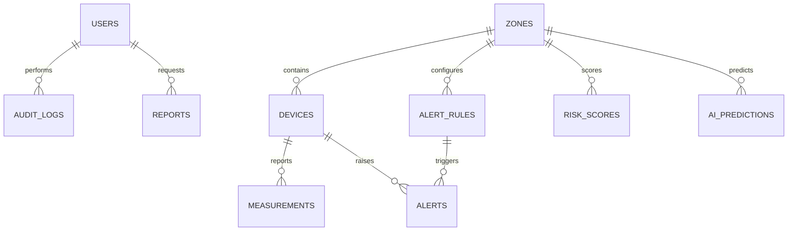

# Phase 1 — MongoDB Schema and Index Strategy

**Database:** MongoDB 7.x
**Driver:** Motor (async) from the backend only. Dashboard, mobile, and AI service never connect directly.

## 1. Conventions

- `_id` is an `ObjectId`; public APIs expose it as a string.
- All dates are BSON `Date` in UTC. Examples use MongoDB Extended JSON (`{"$date": ...}`) for readability.
- Field names are `snake_case`; enums are lowercase strings validated in Pydantic v2 **and** by MongoDB `$jsonSchema` validators (defense in depth).
- Every mutable metadata document carries `schema_version: 1`, `created_at`, and `updated_at`.
- Embed only bounded, owned data (relay states, rule levels, notification attempts). Reference unbounded history (measurements, alerts, predictions, audit entries).
- The backend owns writes. The AI service receives feature windows over HTTP and returns results; it has no database credentials.
- Sensitive fields (`password_hash`, tokens, MQTT passwords, certificates) are never returned by any API and never written to audit logs.

## 2. Relationship overview



`measurements` is a time-series collection. Everything else is a normal collection.

## 3. `users`

Purpose: authentication, role assignment, optional zone scoping, and refresh-token invalidation.

```json
{
  "_id": {"$oid": "665f1a2b3c4d5e6f708192a1"},
  "schema_version": 1,
  "email": "admin@factory.local",
  "username": "admin",
  "password_hash": "$2b$12$replace-with-a-real-bcrypt-hash",
  "full_name": "Platform Administrator",
  "role": "admin",
  "zone_ids": [],
  "is_active": true,
  "token_version": 0,
  "failed_login_count": 0,
  "locked_until": null,
  "last_login_at": {"$date": "2026-11-20T09:00:00Z"},
  "preferences": {
    "notifications": {"in_app": true, "push": true, "telegram": false},
    "language": "en"
  },
  "created_at": {"$date": "2026-11-01T08:00:00Z"},
  "updated_at": {"$date": "2026-11-20T09:00:00Z"}
}
```

- `role`: `admin | operator | maintenance | analyst`.
- `zone_ids` empty means all zones; non-empty scopes a user to those zones.
- `token_version` is embedded in refresh tokens; incrementing it revokes all sessions.
- `locked_until` supports temporary lockout after repeated failures.

**Indexes**

| Index | Options | Use |
|---|---|---|
| `{email: 1}` | unique | Login; enforce canonical lowercase email. |
| `{username: 1}` | unique | Login/display. |
| `{role: 1, is_active: 1}` | — | Admin user listing. |
| `{is_active: 1, last_login_at: -1}` | — | Dormant-account review. |

## 4. `zones`

Purpose: stable zone identity, display metadata, and type-specific behavior.

```json
{
  "_id": {"$oid": "665f1a2b3c4d5e6f708192b1"},
  "schema_version": 1,
  "zone_id": "prod-01",
  "name": "Production Line 1",
  "type": "production",
  "description": "Main assembly line and packaging area",
  "location": {"building": "A", "floor": 0, "area": "Hall 1"},
  "timezone": "Europe/Paris",
  "status": "active",
  "display_order": 1,
  "tags": ["line-1", "packaging"],
  "created_at": {"$date": "2026-11-01T08:00:00Z"},
  "updated_at": {"$date": "2026-11-01T08:00:00Z"}
}
```

- `type`: `production | storage | technical`.
- `status`: `active | maintenance | decommissioned`.
- Current risk is **not** denormalized here; read `risk_scores` for the latest value.

**Indexes**

| Index | Options | Use |
|---|---|---|
| `{zone_id: 1}` | unique | Stable external identifier used by MQTT, AI, and URLs. |
| `{type: 1, status: 1}` | — | Grouped zone lists. |
| `{display_order: 1}` | — | Deterministic dashboard ordering. |

## 5. `devices`

Purpose: device registry, capabilities, calibration, current relay/health state.

```json
{
  "_id": {"$oid": "665f1a2b3c4d5e6f708192c1"},
  "schema_version": 1,
  "device_id": "esp32-prod-01",
  "zone_id": "prod-01",
  "name": "ESP32 Production Line 1",
  "hardware_model": "ESP32-WROOM-32 DevKitC",
  "firmware_version": "1.0.0",
  "mqtt_client_id": "esp32-prod-01",
  "mac_address": "AA:BB:CC:DD:EE:01",
  "ip_address": "192.168.10.41",
  "status": "online",
  "last_seen_at": {"$date": "2026-11-20T10:15:30Z"},
  "capabilities": [
    "temperature", "humidity", "noise", "air_quality",
    "pm25", "pm10", "voltage", "relay", "lcd", "leds"
  ],
  "sensors": [
    {
      "parameter": "temperature",
      "model": "DHT22",
      "unit": "°C",
      "calibration": {"offset": -0.3, "scale": 1.0},
      "warmup_s": 2
    }
  ],
  "relays": [
    {
      "relay_id": 1,
      "name": "ventilation",
      "gpio": 25,
      "state": "off",
      "mode": "auto",
      "fail_safe": "off",
      "last_command_at": null
    },
    {
      "relay_id": 2,
      "name": "extraction",
      "gpio": 26,
      "state": "off",
      "mode": "manual",
      "fail_safe": "off",
      "last_command_at": {"$date": "2026-11-20T10:00:00Z"}
    }
  ],
  "health": {
    "rssi": -61,
    "uptime_s": 86400,
    "free_heap_bytes": 118784,
    "buffered_samples": 0,
    "sensor_faults": []
  },
  "created_at": {"$date": "2026-11-01T08:00:00Z"},
  "updated_at": {"$date": "2026-11-20T10:15:30Z"}
}
```

- `status`: `online | offline | degraded | maintenance`.
- `relays.state`: `on | off | unknown`; `relays.mode`: `auto | manual`.
- Current state is a cache of the retained MQTT `state` topic, updated on change, not on every measurement.
- Device credentials are **not** stored here; they live in the broker password file/secret manager.

**Indexes**

| Index | Options | Use |
|---|---|---|
| `{device_id: 1}` | unique | External device identity. |
| `{mqtt_client_id: 1}` | unique | Broker identity mapping. |
| `{zone_id: 1, status: 1}` | — | Zone device cards. |
| `{status: 1, last_seen_at: 1}` | — | Offline sweeper: find stale online devices. |
| `{zone_id: 1, name: 1}` | — | Admin listing. |

## 6. `measurements` (time-series)

Purpose: immutable sensor history.

```json
{
  "_id": {"$oid": "665f1a2b3c4d5e6f708192d1"},
  "timestamp": {"$date": "2026-11-20T10:15:30.120Z"},
  "meta": {
    "zone_id": "prod-01",
    "device_id": "esp32-prod-01",
    "parameter": "temperature",
    "unit": "°C"
  },
  "value": 31.4,
  "quality": "good",
  "source": "sensor",
  "seq": 18422,
  "ingested_at": {"$date": "2026-11-20T10:15:30.310Z"}
}
```

- `value` is always numeric; booleans/states never go into this collection.
- `quality`: `good | suspect | bad`. Bad readings are stored for traceability but excluded from alerts/aggregates by default.
- `source`: `sensor | simulator | backfill`.
- `seq` is a device-monotonic counter used for replay and deduplication.
- `meta` is immutable per time-series bucket. Changing zone/device/parameter/unit creates a new bucket; never rewrite it.
- `ingested_at` is backend time; alert duration uses the device `timestamp`, with a clock-skew guard.

**Collection creation**

```js
db.createCollection("measurements", {
  timeseries: {
    timeField: "timestamp",
    metaField: "meta",
    granularity: "seconds"
  },
  expireAfterSeconds: 63072000
});
```

`63072000` seconds = 730 days = 24 months. At 10 s cadence, 7 parameters × 7 zones ≈ 5 inserts/s; `seconds` granularity is appropriate.

**Indexes**

| Index | Options | Use |
|---|---|---|
| `{"meta.zone_id": 1, "meta.parameter": 1, "timestamp": -1}` | — | Primary history query: one zone + one parameter + date range. |
| `{"meta.device_id": 1, "timestamp": -1}` | — | Device diagnostics and replay verification. |
| `{"meta.zone_id": 1, "timestamp": -1}` | — | Zone-wide heatmap, correlations, multi-parameter windows. |
| `{timestamp: -1}` | internal/TTL | Time-series bucket index + retention. Do not duplicate unnecessarily. |

Query rule: always provide `meta.zone_id` (and ideally `meta.parameter`) plus a bounded `timestamp` range. Never run an unbounded collection scan from an API route.

## 7. `alert_rules`

Purpose: versioned, per-zone configuration for threshold, duration, hysteresis, correlation, and predictive alerting.

```json
{
  "_id": {"$oid": "665f1a2b3c4d5e6f708192e1"},
  "schema_version": 1,
  "rule_id": "rule-prod-01-temperature-high",
  "name": "Production temperature — high",
  "zone_id": "prod-01",
  "parameter": "temperature",
  "direction": "high",
  "enabled": true,
  "levels": {
    "info":     {"operator": "gte", "threshold": 30, "min_duration_s": 300, "hysteresis": 0.5},
    "warning":  {"operator": "gte", "threshold": 35, "min_duration_s": 120, "hysteresis": 1.0},
    "critical": {"operator": "gte", "threshold": 45, "min_duration_s": 30,  "hysteresis": 1.0}
  },
  "predictive": {
    "enabled": true,
    "horizon_min": 30,
    "probability_threshold": 0.70,
    "model_name": "threshold_breach"
  },
  "correlations": [
    {
      "correlation_id": "corr-overheat",
      "name": "Possible machine overheating",
      "logic": "all",
      "window_s": 600,
      "min_duration_s": 60,
      "level": "critical",
      "conditions": [
        {"parameter": "temperature", "operator": "gte", "threshold": 35},
        {"parameter": "pm25", "operator": "gte", "threshold": 75}
      ],
      "message": "Temperature and PM2.5 are rising together; inspect the machine and ventilation."
    }
  ],
  "notification_channels": ["websocket", "push"],
  "cooldown_s": 900,
  "version": 3,
  "created_by": {"$oid": "665f1a2b3c4d5e6f708192a1"},
  "created_at": {"$date": "2026-11-01T08:00:00Z"},
  "updated_at": {"$date": "2026-11-20T08:30:00Z"}
}
```

- `direction`: `high | low`; low thresholds use `operator: "lte"` and a separate rule document.
- Levels must be strictly ordered; validation rejects `info >= warning >= critical` for high rules (and the inverse for low rules).
- `correlations` use structured conditions, **never** an evaluated expression string.
- `version` increments on each update; the old value is written to `audit_logs`.
- `cooldown_s` suppresses repeat notifications, not alert creation; an escalation always notifies.

**Indexes**

| Index | Options | Use |
|---|---|---|
| `{rule_id: 1}` | unique | Stable API identifier. |
| `{zone_id: 1, parameter: 1, direction: 1}` | unique | Exactly one high and one low rule per zone/parameter. |
| `{enabled: 1, zone_id: 1, parameter: 1}` | — | Load the active rule cache at startup/refresh. |
| `{zone_id: 1, updated_at: -1}` | — | Admin listing. |

## 8. `alerts`

Purpose: durable alert history and lifecycle. One active alert per `dedup_key`.

```json
{
  "_id": {"$oid": "665f1a2b3c4d5e6f708192f1"},
  "schema_version": 1,
  "alert_id": "alt-01J8Z4Q9K7",
  "dedup_key": "prod-01:temperature:high:critical:threshold:rule-prod-01-temperature-high",
  "active": true,
  "zone_id": "prod-01",
  "device_id": "esp32-prod-01",
  "parameter": "temperature",
  "rule_id": "rule-prod-01-temperature-high",
  "level": "critical",
  "status": "open",
  "source": "threshold",
  "title": "Critical temperature in Production Line 1",
  "message": "Temperature reached 46.2 °C (critical threshold 45 °C) for 42 s.",
  "trigger": {
    "value": 46.2,
    "threshold": 45,
    "operator": "gte",
    "duration_s": 42,
    "correlation_id": null,
    "prediction_id": null
  },
  "risk_score": 82,
  "first_seen_at": {"$date": "2026-11-20T10:14:48Z"},
  "triggered_at": {"$date": "2026-11-20T10:15:30Z"},
  "acknowledged_at": null,
  "acknowledged_by": null,
  "resolved_at": null,
  "resolved_by": null,
  "resolution_note": null,
  "notifications": [
    {"channel": "websocket", "status": "sent", "sent_at": {"$date": "2026-11-20T10:15:30.180Z"}, "error": null},
    {"channel": "push", "status": "pending", "sent_at": null, "error": null}
  ],
  "created_at": {"$date": "2026-11-20T10:15:30.150Z"},
  "updated_at": {"$date": "2026-11-20T10:15:30.180Z"}
}
```

- `level`: `info | warning | critical | predictive`.
- `status`: `open | acknowledged | resolved`.
- `source`: `threshold | correlation | predictive | manual`.
- `dedup_key` format: `{zone_id}:{parameter}:{direction}:{level}:{source}:{rule_id}`; append `:{correlation_id}` for correlations. This prevents a threshold alert and a correlation alert for the same rule/level from suppressing each other.
- `active` is `true` for `open` and `acknowledged`, `false` for `resolved`. This enables a clean partial unique index without `$in` in a partial filter.
- `notifications` is bounded (one entry per configured channel); delivery retries update the entry rather than appending forever.
- `trigger.prediction_id` links a Predictive alert to `ai_predictions.prediction_id`.

**Indexes**

| Index | Options | Use |
|---|---|---|
| `{alert_id: 1}` | unique | Public identifier. |
| `{dedup_key: 1}` | unique, partial `{active: true}` | At most one active alert per rule/level/source condition. |
| `{status: 1, triggered_at: -1}` | — | Alert inbox. |
| `{zone_id: 1, triggered_at: -1}` | — | Zone history. |
| `{level: 1, status: 1, triggered_at: -1}` | — | Critical/predictive work queues. |
| `{acknowledged_by: 1, acknowledged_at: -1}` | — | User activity review. |

## 9. `ai_predictions`

Purpose: immutable inference results for anomaly detection and threshold-breach prediction.

```json
{
  "_id": {"$oid": "665f1a2b3c4d5e6f708192a2"},
  "schema_version": 1,
  "prediction_id": "pred-01J8Z4Q9K8",
  "zone_id": "prod-01",
  "device_id": "esp32-prod-01",
  "parameter": "temperature",
  "prediction_type": "threshold_breach",
  "model": {
    "name": "threshold_breach",
    "version": "2026.11.1",
    "framework": "sklearn",
    "artifact_sha256": "6f1c..."
  },
  "score": 0.87,
  "is_anomaly": false,
  "probability": 0.87,
  "threshold": 0.70,
  "horizon_min": 30,
  "expected_value": 46.8,
  "confidence": 0.91,
  "features_window": {
    "from": {"$date": "2026-11-20T09:45:30Z"},
    "to": {"$date": "2026-11-20T10:15:30Z"},
    "sample_count": 180
  },
  "contributing_factors": [
    {"feature": "temp_rolling_mean_15m", "contribution": 0.42},
    {"feature": "temp_slope_30m", "contribution": 0.31},
    {"feature": "pm25_rolling_mean_15m", "contribution": 0.14}
  ],
  "risk_contribution": 25,
  "created_at": {"$date": "2026-11-20T10:15:30.400Z"},
  "expires_at": {"$date": "2027-02-18T10:15:30.400Z"}
}
```

- `prediction_type`: `anomaly | threshold_breach`.
- `score` is the selected model's normalized output; `probability` is populated for breach prediction; `is_anomaly` for anomaly classification.
- `features_window` proves which data produced the result, without copying the raw samples.
- `contributing_factors` powers explanations in the dashboard; top 5 only.
- `expires_at` is 90 days after creation; TTL removes old predictions.

**Indexes**

| Index | Options | Use |
|---|---|---|
| `{prediction_id: 1}` | unique | Public identifier / alert linkage. |
| `{zone_id: 1, created_at: -1}` | — | Latest predictions per zone. |
| `{zone_id: 1, parameter: 1, created_at: -1}` | — | Parameter drill-down. |
| `{prediction_type: 1, created_at: -1}` | — | Model monitoring. |
| `{model.name: 1, model.version: 1, created_at: -1}` | — | Compare deployed model versions. |
| `{expires_at: 1}` | TTL, `expireAfterSeconds: 0` | 90-day retention. |

## 10. `risk_scores`

Purpose: explainable, periodically recomputed zone risk history.

```json
{
  "_id": {"$oid": "665f1a2b3c4d5e6f708192a3"},
  "schema_version": 1,
  "score_id": "risk-01J8Z4Q9K9",
  "zone_id": "prod-01",
  "window_start": {"$date": "2026-11-20T10:15:00Z"},
  "score": 72,
  "level": "high",
  "previous_score": 58,
  "delta": 14,
  "components": {
    "threshold": 30,
    "anomaly": 20,
    "trend": 12,
    "air_quality": 10
  },
  "drivers": [
    {"parameter": "temperature", "contribution": 18, "reason": "Sustained rise above warning threshold"},
    {"parameter": "pm25", "contribution": 11, "reason": "Correlated rise with temperature"}
  ],
  "model_version": "risk-v1",
  "computed_at": {"$date": "2026-11-20T10:15:35Z"},
  "valid_until": {"$date": "2026-11-20T10:16:35Z"},
  "expires_at": {"$date": "2027-05-19T10:15:35Z"}
}
```

- `score` is 0–100. `components` are contribution points that sum to `score`; their maximum possible total is 100 (threshold ≤35, anomaly ≤30, trend ≤20, air quality ≤15). The formula is documented in `07-thresholds.md`.
- `window_start` is truncated to the minute; a unique compound index makes recomputation idempotent for the same minute.
- `level`: `low | moderate | high | critical`.
- `expires_at` is 180 days; TTL removes old history.

**Indexes**

| Index | Options | Use |
|---|---|---|
| `{score_id: 1}` | unique | Public identifier. |
| `{zone_id: 1, computed_at: -1}` | — | Latest score / trend chart. |
| `{zone_id: 1, window_start: 1}` | unique | Idempotent per-minute recomputation. |
| `{level: 1, computed_at: -1}` | — | Zone ranking / critical review. |
| `{expires_at: 1}` | TTL, `expireAfterSeconds: 0` | 180-day retention. |

## 11. `reports`

Purpose: metadata and provenance for generated PDF/CSV/JSON reports.

```json
{
  "_id": {"$oid": "665f1a2b3c4d5e6f708192a4"},
  "schema_version": 1,
  "report_id": "rep-01J8Z4Q9KA",
  "type": "weekly_ai",
  "format": "pdf",
  "zone_ids": ["prod-01", "prod-02", "prod-03"],
  "period": {
    "from": {"$date": "2026-11-09T00:00:00Z"},
    "to": {"$date": "2026-11-16T00:00:00Z"}
  },
  "status": "completed",
  "requested_by": {"$oid": "665f1a2b3c4d5e6f708192a1"},
  "summary": {
    "alerts_total": 42,
    "critical": 3,
    "anomalies": 17,
    "average_risk": 54,
    "recommendations": 4
  },
  "file": {
    "filename": "weekly-ai-2026-W46.pdf",
    "content_type": "application/pdf",
    "size_bytes": 482113,
    "sha256": "2f8c...",
    "storage_path": "/data/reports/weekly-ai-2026-W46.pdf"
  },
  "error": null,
  "created_at": {"$date": "2026-11-16T07:00:00Z"},
  "generated_at": {"$date": "2026-11-16T07:00:12Z"},
  "expires_at": {"$date": "2027-11-16T07:00:12Z"}
}
```

- `type`: `daily | weekly_ai | incident | custom`.
- `format`: `pdf | csv | json`.
- `status`: `queued | generating | completed | failed`.
- `storage_path` is internal; downloads go through an authorized backend route, never a public static path.
- `sha256` allows integrity verification after download.
- The TTL only removes metadata. A scheduled cleanup job deletes the referenced file when metadata expires; otherwise files leak in the report volume.

**Indexes**

| Index | Options | Use |
|---|---|---|
| `{report_id: 1}` | unique | Public identifier. |
| `{requested_by: 1, created_at: -1}` | — | "My reports". |
| `{type: 1, created_at: -1}` | — | Report catalog. |
| `{status: 1, created_at: 1}` | — | Worker queue / stale job detection. |
| `{zone_ids: 1, created_at: -1}` | multikey | Zone-filtered report history. |
| `{expires_at: 1}` | TTL, `expireAfterSeconds: 0` | 12-month metadata retention. |

## 12. `audit_logs`

Purpose: append-only record of sensitive actions. No update/delete API is exposed.

```json
{
  "_id": {"$oid": "665f1a2b3c4d5e6f708192a5"},
  "schema_version": 1,
  "audit_id": "aud-01J8Z4Q9KB",
  "timestamp": {"$date": "2026-11-20T10:00:00.120Z"},
  "actor": {
    "user_id": {"$oid": "665f1a2b3c4d5e6f708192a1"},
    "email": "operator@factory.local",
    "role": "operator",
    "ip": "192.168.10.77",
    "user_agent": "Mozilla/5.0 ..."
  },
  "action": "relay.command",
  "resource": {"type": "device", "id": "esp32-prod-01"},
  "zone_id": "prod-01",
  "outcome": "success",
  "request_id": "req-01J8Z4Q9KC",
  "changes": {
    "before": {"relay_2": "off"},
    "after": {"relay_2": "on"}
  },
  "metadata": {
    "command_id": "9c2e...",
    "source": "dashboard",
    "expires_at": {"$date": "2026-11-20T10:00:30Z"}
  },
  "prev_hash": "8a1d...",
  "hash": "c4f2..."
}
```

- `action` examples: `auth.login`, `auth.refresh`, `user.create`, `user.role_change`, `rule.update`, `alert.acknowledge`, `alert.resolve`, `relay.command`, `report.generate`, `ai.retrain`.
- `outcome`: `success | failure | denied`.
- `changes` is redacted before writing: never store passwords, hashes, tokens, or certificate private keys.
- `prev_hash`/`hash` form a tamper-evident SHA-256 chain. The hash covers canonical JSON of the document (excluding `_id`, `prev_hash`, `hash`) plus `prev_hash`.
- Serialize hash-chain writes (single audit worker or a transaction/lock); concurrent writers would fork the chain. A nightly verifier can recompute hashes and flag gaps.
- Audit writes for sensitive actions are fail-closed: if the audit insert fails, the action is aborted.

**Indexes**

| Index | Options | Use |
|---|---|---|
| `{audit_id: 1}` | unique | Public identifier. |
| `{timestamp: -1}` | — | Global audit feed. |
| `{actor.user_id: 1, timestamp: -1}` | — | Per-user activity. |
| `{action: 1, timestamp: -1}` | — | Security review by action. |
| `{resource.type: 1, resource.id: 1, timestamp: -1}` | — | Resource history. |
| `{zone_id: 1, timestamp: -1}` | — | Zone audit. |

No TTL: retain 2 years via a scheduled archive job, then export and purge with a separate approved procedure.

## 13. Index and retention summary

| Collection | Key index | Unique | Retention |
|---|---|---|---|
| `users` | `{email:1}`, `{username:1}` | Yes | Until deactivation + policy |
| `zones` | `{zone_id:1}` | Yes | Permanent |
| `devices` | `{device_id:1}`, `{mqtt_client_id:1}` | Yes | Permanent |
| `measurements` | `{meta.zone_id:1, meta.parameter:1, timestamp:-1}` | No | 24 months (TTL) |
| `alert_rules` | `{zone_id:1, parameter:1, direction:1}` | Yes | Versioned; old versions in audit |
| `alerts` | `{dedup_key:1}` active; `{status:1, triggered_at:-1}` | Partial | 5 years (archive) |
| `ai_predictions` | `{zone_id:1, created_at:-1}`, `{expires_at:1}` TTL | No | 90 days (TTL) |
| `risk_scores` | `{zone_id:1, window_start:1}` unique; `{expires_at:1}` TTL | Yes / TTL | 180 days (TTL) |
| `reports` | `{report_id:1}`, `{expires_at:1}` TTL | Yes | 12 months (TTL) |
| `audit_logs` | `{timestamp:-1}`, `{actor.user_id:1, timestamp:-1}` | No | 2 years (archive) |

**Indexing rules**

1. Equality fields first, then sort field, then range field (`zone_id → parameter → timestamp`).
2. Never index `value` or free-text messages; use aggregation/Atlas Search only if genuinely needed.
3. Partial unique indexes enforce "one active alert" without blocking resolved duplicates.
4. TTL indexes are only for ephemeral data; audit and alerts are archived, not silently expired.
5. Create all indexes idempotently at startup from a single `indexes.py`; a failed unique-index build must fail the service startup, not be ignored.

## 14. Seed plan

| Object | Seed |
|---|---|
| Admin | Email `admin@factory.local`; bcrypt hash of `SEED_ADMIN_PASSWORD`; force password change. |
| Zones | `prod-01` Production Line 1; `prod-02` Production Line 2; `prod-03` Assembly & Packaging; `store-01` Raw Materials; `store-02` Finished Goods; `tech-01` Electrical Room; `tech-02` Control/Server Room. |
| Devices | One `esp32-<zone_id>` per zone, status `offline` until first heartbeat; two relays with `fail_safe: "off"`. |
| Alert rules | Generated from `07-thresholds.md`: high and low rules for temperature, humidity, voltage; high rules for noise, air quality, PM2.5, PM10. |
| Correlations | Overheating, condensation, dust event, electrical stress, ventilation failure. Attach each correlation to exactly one owning high-direction rule; `correlation_id` is the dedup key. |
| Users | Admin only; operators/maintenance/analysts created by the admin. |

Seed is idempotent: rerunning it must not duplicate zones/devices/rules or reset a changed admin password.
