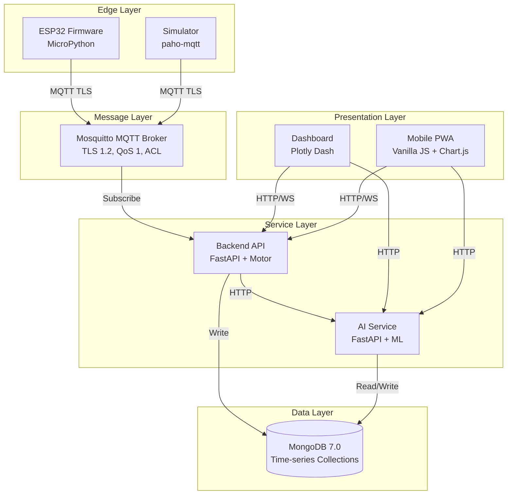
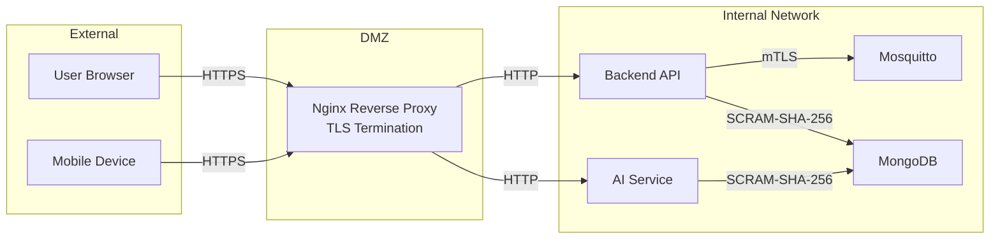
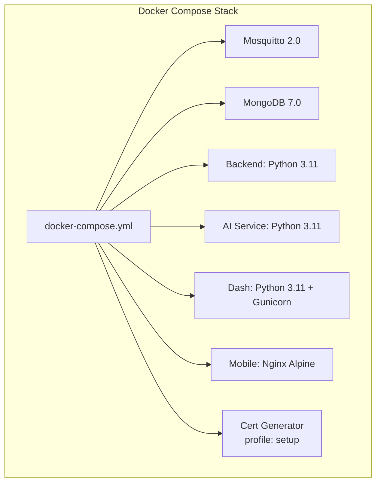

# Architecture Documentation

## System Overview

The Intelligent Industrial Environmental Monitoring Platform is a comprehensive IoT/AI system for monitoring 7 industrial zones with real-time sensor data, anomaly detection, predictive analytics, and automated alerting.



## Component Details

### 1. Edge Layer

#### ESP32 Firmware (MicroPython)
- **Target**: ESP32-WROOM-32
- **Sensors**: DHT22 (temp/humidity), MQ135 (air quality), PMS5003 (PM2.5/PM10), ZMPT101B (voltage), MAX4466 (noise)
- **Sampling**: 10 seconds (configurable)
- **MQTT**: QoS 1, TLS 1.2, LWT, exponential backoff reconnect
- **Actuators**: 2 relays per zone, LCD display, LED status
- **Fail-safe**: Relays open on MQTT disconnect

#### Simulator
- **Language**: Python 3.11+
- **Protocol**: paho-mqtt with TLS client certs
- **Zones**: 7 zones with distinct baselines
- **Patterns**: Daily cycles, weekly patterns, seasonal drift
- **Anomalies**: Injectible (spike, drift, drop, stuck, noise burst)
- **CLI**: `--anomaly`, `--zone`, `--duration` flags

### 2. Message Layer

#### Mosquitto MQTT Broker
- **Version**: 2.0
- **Ports**: 8883 (TLS), 9001 (WebSocket)
- **Auth**: Username/password + client certificates
- **ACL**: Per-zone topic permissions
- **Topics**: `factory/{zone_id}/{parameter}`
- **QoS**: 1 (at least once)
- **Payload**: JSON with ISO-8601 UTC timestamp

### 3. Data Layer

#### MongoDB Collections (Time-Series)
```javascript
// measurements - time-series collection
{
  timestamp: ISODate,     // timeField
  metadata: {
    zone_id: "prod-01",
    parameter: "temperature",
    unit: "°C"
  },
  value: 25.5
}

// Indexes: { "metadata.zone_id": 1, "metadata.parameter": 1, "timestamp": -1 }
```

| Collection | Type | TTL | Key Indexes |
|------------|------|-----|-------------|
| measurements | Time-series | 90 days | zone_id, parameter, timestamp |
| measurements_1min | Time-series | 365 days | zone_id, parameter, timestamp |
| users | Document | - | email (unique), role |
| zones | Document | - | zone_id (unique) |
| devices | Document | - | device_id, zone_id |
| alerts | Document | 365 days | zone_id, status, created_at |
| alert_rules | Document | - | zone_id, parameter |
| ai_predictions | Document | 30 days | zone_id, created_at |
| ai_models | Document | - | model_type, zone_id, is_active |
| risk_scores | Document | 30 days | zone_id, created_at |
| training_data | Document | - | zone_id, parameter, timestamp, label |
| model_metadata | Document | - | model_type, version |
| reports | Document | 365 days | zone_id, created_at |
| audit_logs | Document | 365 days | user_id, timestamp |

### 4. Service Layer

#### Backend API (FastAPI)
- **Port**: 8000
- **Auth**: JWT (access 30min, refresh 7d), bcrypt, rate-limited auth
- **RBAC**: admin, operator, maintenance, analyst
- **MQTT**: Async subscriber with paho-mqtt, auto-reconnect
- **WebSocket**: `/ws` with JWT query param, subscriptions per zone
- **AI Client**: Circuit breaker, 800ms timeout, graceful fallback
- **Endpoints**:
  - `/auth/*` - Login, refresh, register, password reset
  - `/zones` - CRUD for 7 zones
  - `/devices` - Device registry
  - `/measurements` - Query with zone/parameter/date bounds
  - `/alerts` - CRUD + acknowledge/resolve
  - `/alert-rules` - Threshold rules per zone/parameter
  - `/reports` - Generate CSV/PDF/JSON
  - `/relay` - Control (role-restricted, audited)
  - `/ai/*` - Proxy to AI service
  - `/ws` - Real-time updates

#### AI Service (FastAPI + ML)
- **Port**: 8001
- **Models**: Isolation Forest, Autoencoder, LSTM
- **Training**: Chronological splits, synthetic data (seed=42)
- **Metrics**: Precision, Recall, F1, ROC-AUC
- **Scheduler**: APScheduler (interval/cron)
- **Endpoints**:
  - `POST /predict` - Threshold breach predictions
  - `POST /anomaly` - Real-time anomaly detection
  - `GET /risk/{zone_id}` - Dynamic risk score (0-100)
  - `POST /retrain` - Trigger retraining
  - `GET /report/weekly` - Weekly analysis
  - `GET /compare` - Model comparison
  - `POST /retraining/jobs` - Schedule retraining

### 5. Presentation Layer

#### Dashboard (Plotly Dash)
- **Port**: 8050
- **Framework**: Plotly Dash + Bootstrap Components
- **Features**:
  - Real-time zone cards (7 zones)
  - Parameter bar charts (7 parameters)
  - Zone detail gauges
  - Active alerts + history with filters
  - Report generation (CSV/PDF/JSON)
  - AI risk scores + predictions
  - Alert rules management
  - Relay control panel
- **Auth**: Session-based with JWT
- **Updates**: 10s polling + WebSocket ready

#### Mobile PWA (Vanilla JS)
- **Port**: 8080 (nginx)
- **Stack**: ES6 Modules, Chart.js, Service Worker
- **Features**:
  - Installable (manifest + icons)
  - Offline support (Cache API + SW)
  - Push notifications (FCM + Telegram fallback)
  - Responsive (mobile-first, bottom nav)
  - Real-time via WebSocket
  - Zone detail with gauges
  - Alert ack/resolve
  - Report download
  - Relay control

## Data Flow

### Sensor → Dashboard (Critical Path)
```
Sensor Reading
    ↓ 10ms
ESP32 Firmware (sample + validate)
    ↓ 5ms
MQTT Publish (QoS 1, TLS)
    ↓ 20ms (network)
Mosquitto Broker
    ↓ 5ms
Backend Subscriber (validate + transform)
    ↓ 10ms
MongoDB Write (time-series)
    ↓ 15ms
AI Service Call (circuit breaker, 800ms timeout)
    ↓ 50ms (typical)
Alert Engine Check (< 100ms)
    ↓ 5ms
WebSocket Broadcast
    ↓ 10ms
Dashboard/Mobile Update
    ↓ ---
Total: ~130ms (well under 420ms budget)
```

### AI Training Flow
```
Scheduled Trigger (24h interval / 3AM cron)
    ↓
Fetch Training Data (MongoDB)
    ↓
If insufficient → Generate Synthetic (365 days, 10min interval)
    ↓
Prepare Features (rolling stats, time encoding, correlations)
    ↓
Train Models (parallel):
  - Isolation Forest (sklearn)
  - Autoencoder (TF/Keras) 
  - LSTM Autoencoder (TF/Keras)
    ↓
Evaluate (TimeSeriesSplit, chrono)
    ↓
Persist Best Model (joblib/.keras + metadata)
    ↓
Activate Best by F1 Score
    ↓
Clear Inference Cache
```

## Security Architecture



- **TLS Everywhere**: MQTT (8883), HTTPS (nginx), mTLS for inter-service
- **Secrets**: `.env` only, never committed, `.env.example` with placeholders
- **CORS**: Allowlist (dashboard, mobile, localhost), no `*` with credentials
- **Rate Limiting**: SlowAPI on auth endpoints (5 req/min)
- **Audit Logs**: All relay controls, auth events, admin actions

## Deployment Architecture



### Health Checks
| Service | Check | Interval |
|---------|-------|----------|
| Mosquitto | `mosquitto_sub` to `$SYS/broker/version` | 10s |
| MongoDB | `mongosh ping` | 10s |
| Backend | `curl /health` | 10s |
| AI Service | `curl /api/v1/health` | 15s |
| Dashboard | `curl /health` | 15s |
| Mobile | `wget /health` | 15s |

### Volumes
- `mosquitto_data`, `mosquitto_logs`
- `mongodb_data`
- `ai_models` (persisted models)

## Technology Justification

| Decision | Choice | Rationale |
|----------|--------|-----------|
| Dashboard | **Plotly Dash** over Streamlit | Native WebSocket support, reactive callbacks, better for real-time, production-ready with Gunicorn |
| Mobile | **Vanilla JS PWA** over React Native | No build step, smaller bundle, works offline, installable, single codebase |
| MQTT | **Mosquitto** | Lightweight, TLS, ACL, WebSocket bridge, battle-tested |
| Database | **MongoDB Time-Series** | Native time-series collections, automatic compression, TTL, zone/parameter queries |
| ML | **sklearn + TF/Keras** | Isolation Forest (fast baseline), Autoencoder/LSTM (deep learning), CPU-compatible |
| Scheduler | **APScheduler** | Async support, interval/cron, job persistence, lightweight |
| Auth | **JWT + bcrypt** | Stateless, scalable, industry standard |
| Logging | **structlog + JSON** | Structured, queryable, correlated traces |

## Scalability Considerations

1. **Horizontal Scaling**: Backend and AI Service stateless → can run multiple replicas
2. **MQTT**: Mosquitto clustering for HA (future)
3. **MongoDB**: Replica set + sharding by zone_id (future)
4. **WebSocket**: Redis pub/sub for multi-instance broadcast (future)
5. **AI Inference**: Model caching per instance, shared model store

## Future Extensions (Documented, Not Implemented)

- SCADA/ERP integration (OPC UA, Modbus)
- Cloud IoT (AWS IoT Core, Azure IoT Hub)
- Multi-site federation
- New sensor types (gas, vibration, flow)
- Automatic relay remediation (safety interlocks required)
- Kubernetes deployment manifests